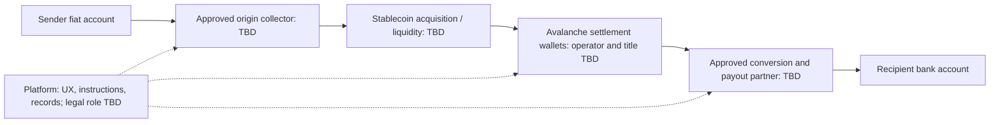

# Market, Costs, Legal Perimeter and Partner Research

Version 1.0 · Research cutoff: 15 October 2026, Asia/Bangkok

This document records research and outstanding commercial/legal questions. It is not a signed agreement, a provider approval or a legal opinion authorizing this team's operation. Recheck source terms, current rules and actual quotes before making a production decision. A capability described publicly may require onboarding, a different legal entity or a separately negotiated program.

## 1. Findings and confidence

| Finding | Assessment | Evidence needed next |
| --- | --- | --- |
| Fiat → stablecoin settlement → fiat is technically feasible | Supported as an architecture; commercial examples exist | Team's own working testnet implementation |
| This exact team can run general US↔Thailand P2P with selected partners | Unconfirmed | Written program/corridor approval and role analysis |
| Avalanche is suitable for a testnet demo | Supported by Fuji tooling and test USDC availability | Actual transaction and recovery tests |
| Every potential fiat partner supports USDC on Avalanche | Unconfirmed | Exact token/network support in the approved program |
| Stablecoin settlement will make our all-in price lower | Hypothesis | Comparable executable quotes and operating cost model |
| Users need a crypto wallet | Not required by proposed UX | Backend/partner custody and signing design |
| Hidden crypto or no stored balance removes regulation | Unsupported inference | Analyze actual activities, control and contracts |
| AI is necessary for the product | No identified MVP need | Owner deferred it |

## 2. Production funds flow: a role map, not a selected program



For every arrow establish the legal entity, contracting customer, account owner, beneficial ownership/title, who controls funds or keys, who owes the recipient, who may freeze or reverse, and who bears losses. “Partner handles compliance” is not an adequate role definition.

The USD→THB route requires approved US-origin collection plus approved Thai payout. The THB→USD route requires separate Thai-origin collection/FX analysis and US payout permissions. Destination coverage does not prove origin coverage or reverse-direction availability.

## 3. Why the method might cost less

Traditional correspondent transfers can involve several intermediaries, separate reconciliations, banking cutoffs and prefunded balances. A stablecoin settlement leg may reduce some of these steps, permit continuous settlement and change working-capital requirements. [SCB's Lightnet announcement](https://www.scb.co.th/en/about-us/news/oct-2024/scb-partners-stablecoin.html) describes a stablecoin-backed cross-border project that graduated from a Bank of Thailand sandbox. It is a precedent for the architecture, not approval for our team or proof of Avalanche support.

The proposed method adds or retains fiat collection costs, stablecoin acquisition/redemption, FX spread, blockchain gas, local payout charges, KYC/AML operations, fraud losses, reserves, chargebacks, support and liquidity. Destination THB may still need to be prefunded even if stablecoins move quickly.

The cost-saving condition is:

```text
Avoided intermediary, reconciliation and capital costs
    > Added conversion, network, partner and risk costs
```

This is a hypothesis about a particular route and funding method. Modern remittance companies also use local collection/payout and efficient treasury systems; comparing only with an expensive SWIFT wire overstates the opportunity. Small gas fees do not establish a low total price, and testnet gas cannot be used as a production fee quote.

Research references from the preceding discussion include the [Federal Reserve's cross-border stablecoin analysis](https://www.federalreserve.gov/econres/notes/feds-notes/payment-stablecoins-and-cross-border-payments-benefits-and-implications-for-monetary-policy-accessible-20260330.htm), [BIS CPMI analysis](https://www.bis.org/cpmi/publ/d220.pdf), and a [Banca d'Italia study](https://www.bancaditalia.it/pubblicazioni/mercati-infrastrutture-e-sistemi-di-pagamento/approfondimenti/2026-086/index.html?com.dotmarketing.htmlpage.language=1). These were discussed earlier; the particular studies are not a measurement of this team's US–Thailand program and were not re-audited in full while packaging this handoff.

## 4. Cost comparison method

For USD→THB define:

- `D`: total USD debited from sender, including charges paid outside the app if applicable.
- `R`: THB actually received net of receiving-side charges.
- `M`: contemporaneous reference mid-market THB per USD.

```text
All-in cost (%) = 100 × [1 − R / (D × M)]
```

For THB→USD use total THB debit, net USD receipt and the matching USD-per-THB reference rate. Do not invert one provider's retail rate and call it the reference rate. Keep timing, funding method, recipient route and transfer purpose comparable.

Illustrative arithmetic: if the total debit is USD 10, reference rate is 35 THB/USD and net receipt is THB 343, the all-in cost is 2%. These numbers are invented to explain measurement; they are not our actual fee schedule or a competitor quote.

Collect quotes at USD 10, 25, 50, 100 and 1,000 equivalents. Separate first-transfer promotions from repeat-user prices. A fixed USD 1.99 fee alone is 19.9% of USD 10 and 1.99% of USD 100, but that arithmetic says nothing about additional FX or receiving charges.

| Cost/quote field | Capture |
| --- | --- |
| Time and eligibility | Timestamp/timezone, sender country/address/account type and applicable state |
| Funding | Bank/card method, card type, provider fee and external issuer/bank charges |
| FX | Reference rate/time, provider rate, spread, quote expiry and guarantee |
| Settlement | Token acquisition fee/spread, chain fee, redemption/off-ramp cost |
| Payout | Bank/card/cash route, partner charge, receiving deductions and currency |
| Outcome | Total source debit, final net receipt, estimated and observed delivery time |
| Commercial assumptions | Partner minimums, reserves, monthly fees, prefunding, failures and refunds |
| Evidence | Screenshot or quote reference without personal/financial credentials |

Unknown charges are UNKNOWN, not zero. Keep customer-facing fees separate from the platform's cost of service and gross margin. A subsidized demo price is not evidence of sustainable economics.

## 5. Competitors usable in the Thailand corridor

The owner requested two groups: services a Thailand-based sender can use, and services where a US sender can pay into Thailand. Do not mix the groups or assume that destination support means Thai residents can originate a transfer.

### 5.1 Thailand-origin alternatives

| Service | Relevance | Qualification and source |
| --- | --- | --- |
| Wise | THB-origin transfers for eligible Thailand-address personal profiles | Current guide describes Thai-bank QR/Biller funding; business profiles are excluded from sending THB. [Wise THB guide](https://wise.com/help/articles/2932335/guide-to-thb-transfers) |
| Western Union Thailand | Thailand-to-US route | Account eligibility, funding, payout type and FX affect quote. [Thailand→US](https://www.westernunion.com/th/en/send-money-to-usa.html) |
| DeeMoney | Thai outbound remittance; specific USD SWIFT option discussed | SHA/OUR fee treatment and receiving charges differ. [USD SWIFT guide](https://deemoney.com/promotions/complete-guide-to-usd-swift-transfers) |
| K PLUS / Kasikorn | App-based international transfers | Supported partner and SWIFT paths must be compared separately. [K PLUS international transfers](https://www.kasikornbank.com/th/International-Business/global-money-transfer/Pages/international-transferviakplus.aspx) |
| SCB EASY | International transfers from Thailand | Destination, route, eligibility and live quote matter. [SCB EASY international service](https://www.scb.co.th/en/personal-banking/other-services/ripple/scb-easy-app.html) |

An earlier blanket claim that Wise cannot originate THB is superseded by its current help guide. Do not reuse that old claim in a pitch.

### 5.2 US-origin services delivering into Thailand

| Service | Relevance | Source / comparison note |
| --- | --- | --- |
| Wise | US→Thai bank transfers | [US→Thailand](https://wise.com/us/send-money/send-money-to-thailand); compare matched funding methods |
| Remitly | US→Thailand remittances | [Route page](https://www.remitly.com/us/en/money-transfer/send-money-to-thailand); separate promotions from repeat prices |
| Paysend | US→Thailand transfers | [Route page](https://paysend.com/en-us/send-money/from-the-united-states-of-america-to-thailand); verify current bank/card route and final quote |
| Western Union US | US→Thailand bank/cash options | [Route page](https://www.westernunion.com/us/en/send-money-to-thailand.html); compare the same recipient delivery method |

PayPal Thailand Friends & Family should not be listed as a normal local P2P feature; the prior review found it unavailable under [PayPal Thailand's relaunch FAQ](https://www.paypal.com/th/digital-wallet/thailand-relaunch-faq). Xoom is a separate product and should not be conflated with that feature; evaluate its [Thailand route](https://www.xoom.com/thailand/send-money) separately if expanding the benchmark.

These are research candidates, not a live ranking. No matched executable quote dataset or measured speed benchmark is included. Apart from the Wise guide recheck, route pages/prices in this table were carried forward from earlier discussion rather than individually re-quoted during handoff preparation.

## 6. Legal perimeter: Thailand

The [Bank of Thailand payment FAQ, question 4.5](https://www.bot.or.th/th/our-roles/payment-systems/payment-act-oversight/payment-faq0.html) describes payment-transfer licensing and international money-transfer-agent permission under the payment-systems and exchange-control frameworks. Questions 4.6 and 4.8 also address foreign providers and KYC. This establishes that international transfers have a regulatory perimeter; it does not decide the exact permissions for the team's unselected contractual role.

Review separately: domestic collection, international transfer, FX, control/holding of stablecoins, digital-asset conversion, payout, consumer communications and personal-data handling. Thai outbound treatment deserves specific review; hiding a stablecoin leg in the backend is not an exemption.

The earlier review also flagged [BOT foreign-exchange guidance](https://www.bot.or.th/content/dam/bot/documents/th/our-roles/financial-markets/foreign-exchange-regulations/FX-Regulation/FX%20regulation%20guideline_1%20dec%2025.pdf). Its application to the exact funds/title flow needs qualified review; no full legal interpretation of that PDF is asserted here.

The [SEC release of 11 September 2026](https://www.sec.or.th/EN/Pages/News_Detail.aspx?SECID=13335) concerns a consultation on proposed stablecoin supervision principles and states a hearing end date of 25 September 2026. Expiry of that comment period is not proof of enactment. This package has not established a subsequent final rule or effective date. Verify final publications before saying the proposed rules apply or do not apply to the production model.

## 7. Legal perimeter: United States

[FinCEN's virtual-currency guidance](https://www.fincen.gov/resources/statutes-regulations/guidance/application-fincens-regulations-persons-administering) treats certain acceptance/transmission or exchange activities as money transmission depending on facts, circumstances and applicable exclusions. A hidden stablecoin leg does not by itself take the activity outside that analysis. Federal MSB issues are distinct from state licensing, authorized-delegate arrangements and other applicable obligations.

The [Texas Department of Banking MSB FAQ](https://dob.texas.gov/money-services-businesses/faqs), discussed previously, is a useful state-specific reference for delegate scope. It is not a nationwide licensing conclusion. Determine the actual sender states and contracting entities before relying on a partner arrangement.

The [CFPB remittance resource page](https://www.consumerfinance.gov/compliance/compliance-resources/deposit-accounts-resources/remittance-transfer-rule/) points to rules on disclosures, estimates, error resolution, cancellation/refunds and agents. Applicability, exceptions and current amendments need review for the approved program. The testnet receipt design is not a claim that statutory disclosures are satisfied.

A regulated partner's contract may allocate tasks while leaving duties with the platform. Obtain explicit agreement on who contracts with the sender, delivers disclosures, handles complaints, refunds and fraud, and bears losses. API access is not an umbrella license.

## 8. Payment processor restrictions

[Stripe's restricted-business policy](https://stripe.com/legal/restricted-businesses) lists peer-to-peer money transmission among prohibited financial activities. A standard merchant checkout is therefore not the assumed collection rail for this product. Approval for a creator/content payment model would not automatically cover general personal remittance.

Card-funded remittance programs can exist through appropriate acquiring/network arrangements; that does not mean ordinary merchant processing qualifies. The earlier review identified [Visa Direct documentation](https://developer.visa.com/docs/visa_direct) as a starting point for funding/push-payment structures. Actual program sponsorship, jurisdiction, use case and responsibilities remain unconfirmed.

For the hackathon use a mock funding adapter, not an ordinary live checkout disguised as a transfer. No card numbers or bank authentication should be collected by this prototype.

## 9. Partner due diligence already discussed

### 9.1 TransFi

The [public Business Services Agreement](https://www.transfi.com/business-services-agreement) raises material questions: embedding approval, differing descriptions of end-user/KYC responsibility, customer authorizations, chargeback liability, reserves and liability limits. Section 14(i) states a minimum 90-day hold on collected funds, while Appendix 2 describes card T+2, ACH timing and a USD 10K minimum settlement threshold. These must be reconciled in the applicable signed program documents. The USD 10K figure is not evidence of a minimum individual consumer transfer. The public terms do not establish approval for this team's general P2P, US/Thai collection, reverse corridor or USDC/Avalanche model. No signed agreement or actual commercial pricing was obtained.

Keep this as a due-diligence lead, not a universal claim about every negotiated TransFi program.

### 9.2 Circle / Circle Payments Network

[Circle Hub Terms, Schedule 1](https://www.circle.com/legal/circle-hub-terms) distinguish products and additional agreements. Managed Payments requires an MSA executed outside the Hub; self-managed CPN references a participation agreement/rulebook; stablecoin pay-ins/payouts also reference an API addendum. Developer access and public marketing do not substitute for these agreements. Restricted agreements were not available for review, and no team approval is established.

The [Thunes–Circle Managed Payments announcement](https://www.thunes.com/news/thunes-joins-circle-payments-network-managed-payments-to-advance-global-payment-interoperability/) supports the general idea of fiat-facing services using stablecoin settlement. It does not prove this team's corridor, onboarding eligibility, exact chain or price.

### 9.3 Thunes

The earlier review identified [THB bank/PromptPay payout documentation](https://docs.thunes.com/money-transfer/v2/#thailand), [general terms](https://www.thunes.com/legal-thunes-terms/), [definitions](https://www.thunes.com/legal-definitions/) and [network-partner terms](https://www.thunes.com/legal-thunes-network-partner-terms/). The order document, legal entity, region and selected service determine the actual arrangement.

The [US regional terms](https://www.thunes.com/legal-usa-region-specific-terms/) describe customer assistance with regulated-entity duties, including receipts/rates, regulatory links, service-provider identification and marketing review. They also describe pooled customer funds held apart from corporate funds. These are useful contracting details, not proof that the proposed platform is accepted or that Thai-origin collection is covered.

### 9.4 DeeMoney and other candidates

[DeeMoney's partner page](https://deemoney.com/partner) is a starting point for inbound Thai payout partnerships. It does not by itself establish an embedded outbound API, permission for the team's stablecoin flow or a complete US-origin program.

Stables, Visa Direct and Mastercard Move were considered as possible components. They are not selected providers. User-facing exchange cash-out and routes on a different network do not prove compatibility with the intended frictionless fiat-to-bank flow on Avalanche. Request exact asset/network, beneficiary, origin and purpose coverage.

## 10. Questions to put into a partner/legal request

Drafting this checklist is not authorization to contact anyone. No outreach has occurred.

1. Is natural-person-to-different-natural-person remittance explicitly permitted? Which purposes are allowed: family/personal, goods, freelance work, prizes or donations?
2. Which sender countries, US states, residence/address types, ages and bank/card types are supported?
3. Are US→Thailand and Thailand→US each approved as origin-to-destination programs, not merely payout destinations?
4. Which legal entity contracts with the sender and recipient? Is the platform a software vendor, registered/appointed agent, distributor or regulated principal?
5. Who collects, holds and owns fiat at each step? Who owes the beneficiary and who controls each wallet/key?
6. Is backend stablecoin settlement expressly approved? Is native USDC on Avalanche C-Chain supported in that particular program?
7. Who performs and retains KYC, sanctions screening, monitoring and regulatory reporting? What data must the platform provide and within what time?
8. When may funds be used? What reserves, prefunding, settlement minimums, cutoffs and withdrawal restrictions apply?
9. Who bears card chargebacks, bank returns, fraud recalls, frozen funds and failed payout losses after irreversible token settlement?
10. What is the complete fee schedule: collection, FX spread, token conversion, gas, payout, monthly minimums, refunds and failed transfers?
11. Who provides quote guarantees, statutory receipts, cancellation/error handling and customer support?
12. What production testing, branding/advertising approvals, security review and contractual documents are required?
13. What data-processing terms, cross-border data arrangements, retention, breach obligations, service levels and termination rights apply?
14. How are inconsistent public terms overridden or resolved in the executed order/MSA? Which document controls?

Deliverables to obtain are actual signed agreements/schedules, written corridor/program approval, fee/reserve schedule, funds/title diagram, compliance-responsibility matrix and qualified advice on the specific structure. A website statement alone does not satisfy these items.

## 11. Claims allowed in the pitch

| Reasonable statement | Statement not yet supported |
| --- | --- |
| “We demonstrate a fiat-facing journey with testnet stablecoin settlement on Avalanche.” | “We have completed an international bank transfer.” |
| “Funding and payout are simulations in this prototype.” | “Our Thai bank/PromptPay integration is live.” |
| “This architecture may reduce some settlement overhead.” | “Every transfer is cheaper than banks/Wise.” |
| “We are researching licensed partner routes.” | “Partners' licenses automatically cover us.” |
| “The blockchain transaction is publicly verifiable.” | “Blockchain proves the recipient received THB.” |
| “We selected Avalanche for the hackathon demo.” | “All prospective fiat partners support Avalanche.” |

## 12. Provenance and freshness

### 12.1 Source material

The owner supplied a laptop-transfer archive named `p2p-chat-transfer-2026-10-15.zip`. It was extracted in the current discussion and its manifest entries were hash-checked. The original package contains START-HERE notes, V2 feasibility research, older competitive research, a five-page Thai Word summary, six evidence notes, historical proposals and a visible-message transcript. Those raw materials are not included in this curated package to avoid spreading conversation detail and superseded instructions.

The old creator/esports brief, self-cash-out proposal and original continuation prompt are historical context. This package incorporates the later clarifications about general P2P, US/Thailand demo, Avalanche, deferred AI and optional sponsor use. A preliminary `p2p-demo-architecture.md` was also produced before this expanded specification. This package is the expanded handoff; the preliminary draft should not be treated as a second independent implementation plan.

The historical notes mention an event spreadsheet. Its current contents and detailed judging rules have not been reviewed here. No unverified team size, deadline or event requirement is adopted from it.

### 12.2 Rechecks while preparing this package

Reopened or checked for the relevant points on 15 October 2026: BOT payment FAQ; FinCEN virtual-currency guidance; CFPB remittance resources; Stripe restricted-business policy; TransFi public BSA and 90-day/Appendix-2 clauses; Circle Hub product-agreement schedule; Thunes US terms; SEC consultation announcement; Wise THB guide; SCB stablecoin announcement; Thunes/Circle announcement. Sponsor capabilities and Avalanche/Circle technical configuration were checked in the immediately preceding architecture discussion.

Market route details other than the Wise guide, the earlier cost studies, and some partner/FX background links were carried forward from prior discussion. Do not describe this as a fresh exhaustive audit of all provider services or every legal development. Webpages can change after this cutoff, and no signed partner contracts were reviewed.

### 12.3 Suggested legal review output

Ask qualified counsel/partners for an activity-by-activity conclusion with legal entities, countries/states, roles, customer purpose, fund ownership/control, permissions, contracts and operational obligations. Record exactly what was approved, by whom, for which version of the flow and on which date. Keep the testnet demo decision separate from any real-money launch decision.
