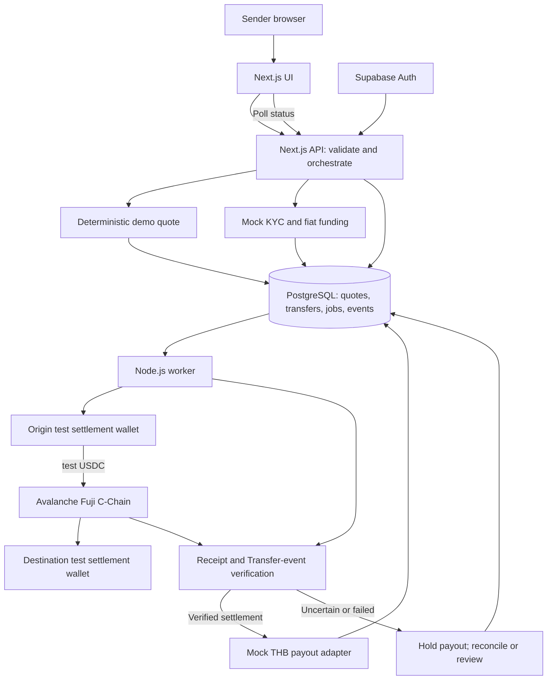
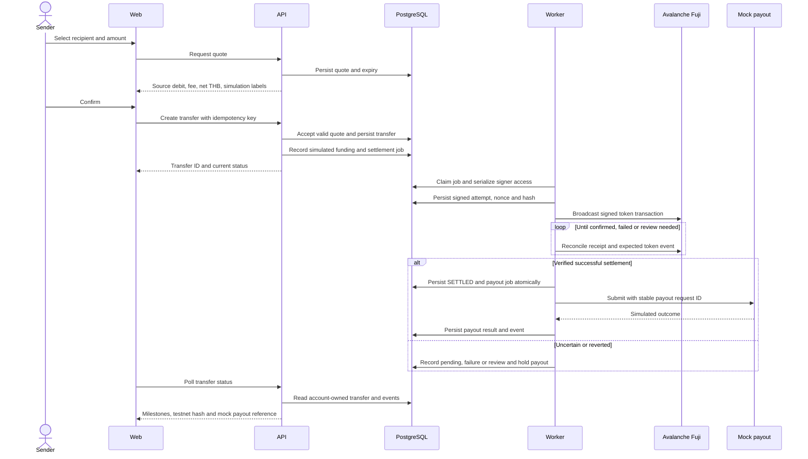
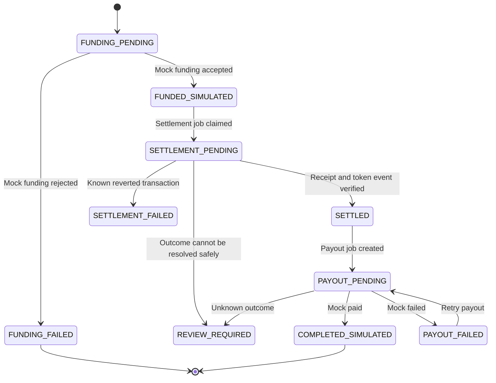

# Proposed Demo Technical Specification

Version 1.0 · 15 October 2026 · Status: proposed, unimplemented

Read [HANDOFF.md](HANDOFF.md) first. Every endpoint, table, module and command convention below is a proposed contract for the team, not an existing implementation. Implementation should confirm the open scope choices before treating this as a frozen specification.

## 1. Architecture choices and tradeoffs

| Choice | Benefit | Tradeoff | Recommendation |
| --- | --- | --- | --- |
| One Next.js app with an API and a separate worker in the same repository | Shared TypeScript types, small operational footprint, background jobs survive page navigation | Two processes still need supervision | Preferred MVP |
| Next.js frontend plus a separate backend service | Independent service ownership and scaling | More deployment/configuration/interfaces for a small demo | Use only if the team already benefits from this split |
| Existing test USDC contract | Real settlement without writing a financial contract | Business transfer ID remains an off-chain association | Preferred baseline |
| Custom settlement contract | Public transfer-ID deduplication and settlement events | More code, tests, deployment and permissions to get right | Optional extension after baseline works or event rules require it |

The database is the durable source of transfer intent. The blockchain is the source of truth for token movement. A mock payout record is the source of truth only for the simulated payout. Do not collapse these three kinds of evidence into a single “paid” flag.

## 2. Proposed stack

| Component | Technology | Reason and responsibility |
| --- | --- | --- |
| UI | Next.js App Router, React, TypeScript | Web screens and server/client separation |
| Styling | Tailwind CSS | Consistent responsive interface with little custom infrastructure |
| API | Next.js Route Handlers, Node runtime | Quote, recipient and transfer endpoints |
| Authentication | Supabase Auth | Seeded demo accounts and authenticated sessions |
| Database | Supabase PostgreSQL | Relational constraints, transactions and durable state |
| Worker | Node.js and TypeScript | Chain submission/reconciliation and simulated payout |
| EVM integration | viem | ABI encoding, signing, sending and receipt reads |
| Network | Avalanche Fuji C-Chain | Selected ecosystem's test environment |
| Token | Circle test USDC on Fuji | Existing test stablecoin |
| Testing | A TypeScript test runner plus browser smoke tests | Choose the runner with the actual project setup; no installed runner is implied |
| Runtime | Local app and worker first | Public hosting is an open requirement |

Use compatible stable versions when scaffolding and commit the resulting lockfile. This package does not prescribe unverified “latest” version numbers. Check the selected Next.js version's Node requirement before installing.

Official capability references: [Next.js backend guide](https://nextjs.org/docs/app/guides/backend-for-frontend), [Supabase PostgreSQL](https://supabase.com/docs/guides/database/overview), [Supabase Auth](https://supabase.com/docs/guides/auth), [viem public actions](https://viem.sh/docs/actions/public/introduction).

## 3. Architecture diagram



Origin and destination are logical partner roles. The wallets themselves are not geographically located in a way that proves a cross-border bank transfer. Both wallets are on the same chain. The app never acquires actual USD, THB or mainnet USDC in this demonstration.

## 4. Transaction sequence



## 5. Network configuration

| Setting | Value |
| --- | --- |
| Network | Avalanche Fuji C-Chain |
| Chain ID | 43113 |
| Native gas asset | Test AVAX |
| Public RPC | `https://api.avax-test.network/ext/bc/C/rpc` |
| Token address | `0x5425890298aed601595a70AB815c96711a31Bc65` |
| Expected token decimals | 6; verify on chain at startup |
| Explorer | `https://explorer-test.avax.network/c-chain` |

Network values are documented by [Avalanche](https://docs.avax.network/docs/primary-network); the token address is listed by [Circle](https://developers.circle.com/stablecoins/usdc-contract-addresses). Test tokens have no financial value. Recheck the selected explorer's transaction URL format when implementing; the app should generate valid links rather than guess a path.

At startup, verify RPC chain ID, nonempty token code, token decimals, distinct settlement addresses, signing account and minimum test AVAX/USDC balances. Refuse to run settlement against another chain. Configure allowlisted recipient wallet addresses server-side.

The app does not need a bridge, a new L1 or an AVAX-to-USDC swap. The service pays transaction gas with test AVAX; the transferred asset is test USDC.

## 6. Proposed repository organization

```text
app/
  login/
  send/
  transfers/[id]/
  api/recipients/
  api/quotes/
  api/transfers/
src/
  domain/             # money types, quote policy, transitions and invariants
  server/             # auth, database access and request validation
  adapters/
    funding/mock.ts
    compliance/mock.ts
    fx/fixture.ts
    settlement/avalanche.ts
    payout/mock.ts
  worker/             # job claiming, nonce coordination and reconciliation
  config/             # validated server/public settings
db/
  migrations/
  seed/
tests/
  domain/
  integration/
  browser/
docs/
  decisions/
```

This structure is illustrative. Keep domain operations independent of UI components and place signing modules behind a server-only boundary. Do not add microservices, a separate message broker or a general plugin framework merely to imitate production architecture.

## 7. Monetary rules and quote example

Use integer minor units for fiat: USD cents and THB satang. Use integer token base units for USDC. JSON amounts are decimal strings so callers cannot lose precision through JavaScript number conversion. Reject negative, zero, malformed, over-limit and excessively precise input. Do not calculate money with binary floating point.

Represent an FX rate as a rational numerator/denominator or an exact decimal parsed by an appropriate decimal library. Specify the rounding rule. Proposed fixture rule: round destination minor units down; disclose this rule in the internal calculation record. Do not silently change rounding between quote and payout.

Illustrative example only, not a market price or promise:

| Field | Example |
| --- | --- |
| Sender's total debit | USD 10.00 = 1000 cents |
| Explicit fee included in debit | USD 0.20 = 20 cents |
| Amount converted | USD 9.80 = 980 cents |
| Fixture rate | 35 THB per USD |
| Net payout | THB 343.00 = 34300 satang |
| Test settlement amount | 9.8 test USDC = 9800000 base units |

The example assumes a 1:1 USD-to-test-USDC accounting mapping only for the simulation. No test token is backed by the sender's simulated fiat, and no real redemption is performed. Additional FX spread, funding fees or payout fees are not silently assumed to be zero in a production cost model.

Proposed quote response:

```json
{
  "id": "quote_demo_001",
  "recipientId": "recipient_demo_th_001",
  "sourceCountry": "US",
  "destinationCountry": "TH",
  "sourceCurrency": "USD",
  "destinationCurrency": "THB",
  "sourceDebitMinor": "1000",
  "feeMinor": "20",
  "conversionPrincipalMinor": "980",
  "fxRateNumerator": "35",
  "fxRateDenominator": "1",
  "destinationNetMinor": "34300",
  "settlementTokenUnits": "9800000",
  "expiresAt": "2026-10-15T12:05:00Z",
  "mode": "DEMO",
  "fundingSimulated": true,
  "fxSimulated": true,
  "payoutSimulated": true,
  "chainId": 43113
}
```

The timestamp is a schema example, not a usable quote. Generate expiry from the server clock. A proposed five-minute TTL is configurable, not a partner rule. Only accept a quote once, bind it to its authenticated owner and recipient snapshot, and store the accepted amounts immutably. An already accepted quote is not repriced during a chain delay.

## 8. Proposed data model

All identifiers below are application identifiers; UUIDs are a practical default. Use UTC timestamps in storage and localize display. Record environment/mode on every transfer.

| Entity | Essential fields | Important constraints |
| --- | --- | --- |
| profiles | auth user ID, display name, demo country | Auth identity is not KYC proof |
| recipients | ID, owner ID, fictional name, country, currency, bank fixture | Owner-scoped; no real bank data in demo |
| quotes | ID, owner ID, recipient snapshot, immutable amounts, rate, expiry, accepted time | One accepted transfer per quote; supported corridor only |
| transfers | ID, owner ID, quote ID, idempotency key, request fingerprint, status, version, mode | Unique owner+idempotency key; unique quote ID |
| funding_attempts | ID, transfer ID, provider request ID, simulated status, reason | Unique logical funding operation; safe replay |
| settlement_attempts | ID, transfer ID, chain ID, token, signer, destination, units, nonce, signed tx, hash, receipt block, outcome | Unique chain+signer+nonce and chain+hash; serialize unresolved signer operations |
| payout_attempts | ID, transfer ID, request ID, currency, net amount, simulated status, reference | Stable payout request ID across unknown-outcome retries |
| transfer_events | ID, transfer ID, sequence, previous/new status, reason, attempt reference, time | Append-only; unique transfer+sequence |
| jobs | ID, type, transfer ID, dedupe key, status, lease, attempts, next-run time | Unique logical dedupe key; exclusive claim |

The database stores a history of attempts. Never overwrite an uncertain settlement attempt with a new hash and lose the ability to reconcile it. An append-only event history is an audit aid, not a complete financial ledger. Production would require a designed double-entry ledger, reconciliation controls and appropriate handling of customer liabilities even without a stored-balance UX.

Use database transactions for each state change together with its event and next job. This is a small transactional outbox pattern: a crash must not leave a successful state change without its required follow-up job. Enforce valid transitions in the service/domain layer and use database uniqueness to defend against concurrent requests.

## 9. Proposed API contracts

| Method and route | Purpose | Main rules |
| --- | --- | --- |
| `GET /api/recipients` | List fictional recipients owned by account | Authenticated; no cross-account leakage |
| `POST /api/recipients` | Add a fictional recipient if UI needs it | Validate supported country/currency and synthetic fixture |
| `POST /api/quotes` | Return a persisted quote | Server computes amounts; client cannot supply fees/net payout |
| `POST /api/transfers` | Accept quote and create transfer | `Idempotency-Key` required; quote ownership/expiry and exact request fingerprint checked |
| `GET /api/transfers` | Account transfer history | Paginated and account-scoped |
| `GET /api/transfers/{id}` | Milestones, amounts and safe references | Never return private keys or signed raw transactions |
| `POST /api/demo/transfers/{id}/funding` | Trigger controlled mock funding outcome | Demo operator only, valid current state, idempotent |
| `POST /api/demo/transfers/{id}/payout-retry` | Retry a known failed simulated payout | Settlement already verified; never rerun settlement |

Expected transfer creation request:

```json
{
  "quoteId": "quote_demo_001",
  "purpose": "PERSONAL_REMITTANCE"
}
```

The source amount, recipient and settlement destination are resolved from server-owned records, not accepted as override fields on this call. A future workflow may require a recipient revision; that should create a new quote rather than mutate an accepted transfer.

Idempotency behavior:

- Same authenticated owner, same key, same payload: return the original transfer and current status.
- Same owner and key, different payload: `409 IDEMPOTENCY_CONFLICT`.
- Same quote with another key after acceptance: return a documented conflict rather than create a second transfer.
- Persist the idempotency reservation with creation in one database transaction.

Suggested errors: `400 INVALID_INPUT`, `401 UNAUTHENTICATED`, `404 NOT_FOUND`, `409 IDEMPOTENCY_CONFLICT`, `409 INVALID_STATE`, `410 QUOTE_EXPIRED`, `422 UNSUPPORTED_CORRIDOR`, `429 RATE_LIMITED`, `503 SETTLEMENT_UNAVAILABLE`. Do not leak another account's transfer existence. Authenticated mutations need CSRF protection appropriate to the selected session transport; demo controls must not rely on a visible UI button being hidden.

No production provider webhook is implemented by this proposal. When a real provider is later integrated, add signature verification, replay protection, event deduplication, legal-data handling and reconciliation according to that provider's actual contract.

## 10. State machine

Quote lifecycle is separate: OPEN → ACCEPTED or EXPIRED. A quote is not a funded transfer.



Pre-broadcast setup problems such as insufficient test gas are recorded as blocked jobs with a reason while preserving the funded transfer. They are not fabricated transaction reverts. A timeout alone is not SETTLEMENT_FAILED. REVIEW_REQUIRED is a durable hold with retained evidence; it does not automatically refund, retry or mark success.

An explicit operator action may recover a reviewed or known-failed transfer after evidence is checked. That path must not be a generic “force success” endpoint. A new settlement attempt is allowed only after the previous attempt is conclusively unable to pay, under an intentionally designed retry policy. Automatic new-nonce retries are outside the initial baseline.

## 11. Settlement algorithm and failure recovery

### 11.1 Prepare and submit

1. Claim a due settlement job using a database lease and lock the transfer.
2. Confirm funded-simulated status and that no verified or unresolved prior settlement exists.
3. Hold exclusive access to the service signer. The minimal demo can process only one unresolved transaction at a time per signer; this sacrifices throughput for understandable nonce safety.
4. Validate chain ID, token address, destination allowlist, amount, balances and gas configuration. Verify token decimals on chain rather than trusting a label.
5. Reserve the nonce, build and sign the ERC-20 transfer, compute its hash locally, and persist the signed transaction and attempt before sending it.
6. Broadcast the exact stored bytes. A response saying “already known” or a network timeout does not authorize a different payment.
7. Continue receipt reconciliation using the stored hash. Renew the job lease or let another worker resume from the persisted attempt.

Do not send the signed transaction before the persistence transaction commits. Signed raw bytes are not the private key, but they are executable authorization to move test tokens and should be restricted to the worker, excluded from logs and retained only as needed for reconciliation.

### 11.2 Verify outcome

Check the expected network, transaction hash, receipt success, token contract address, ERC-20 Transfer event, sender wallet, destination wallet and exact base-unit amount. A receipt with a successful status but no matching token event is not sufficient proof of the intended settlement.

A proposed conservative demo setting is two block confirmations followed by a fresh canonical-block/receipt check. This is an application policy, not a claim that Avalanche requires two confirmations. Pin and test the policy against the actual RPC and network behavior before the demonstration. If contradictory reads occur, hold payout and reconcile.

Store receipt block number/hash, observed token event and verification time. Mark SETTLED and enqueue the unique payout job in the same database transaction.

### 11.3 Recover safely

| Situation | Required behavior |
| --- | --- |
| User double-clicks confirm | Return the same transfer |
| Worker crashes before signing | Resume from job; no chain side effect occurred |
| Worker crashes after signed attempt is stored | Reconcile hash; rebroadcast same bytes if appropriate |
| RPC accepted broadcast but response was lost | Query stored hash; never invent a new payment |
| Same nonce appears consumed by an unknown transaction | Hold for review and inspect signer activity |
| Transaction reverted | Preserve failure receipt; do not pay fiat or mark tokens delivered |
| Chain transaction succeeds but database write fails | Reconcile that hash again and persist the single settlement result |
| Payout succeeds but response/database update is lost | Reconcile the stable payout request ID; do not blindly pay again |
| Payout is known failed after chain settlement | Retry only payout with the defined adapter policy |
| UI closes | Worker continues; returning UI reads persisted status |

Leases alone do not guarantee exactly-once money movement. Safety comes from persisted signed attempts, signer serialization, unique constraints, state guards and outcome reconciliation. A direct ERC-20 transfer has no application transfer-ID deduplication built into the token contract.

## 12. Adapter boundaries

| Adapter | Proposed operation | Required outcome information |
| --- | --- | --- |
| Compliance | Evaluate fictional account/transfer | PASS, REJECT or REVIEW plus simulation reason |
| Funding | Collect/query by stable request ID | Accepted, declined, pending or unknown; simulated reference |
| FX | Quote from an identified fixture | Rate, fee breakdown, expiry, rounding and fixture version |
| Settlement | Prepare/broadcast/query a persisted attempt | Hash, chain, expected token details and verified receipt |
| Payout | Submit/query by stable request ID | Paid-simulated, failed, pending or unknown; mock reference |

Mocks should persist outcomes so retries behave realistically. Do not implement “always return success after a timer” as the only payout behavior. Known failure and unknown outcome are different states.

## 13. Screens and user-facing information

| Screen | Essential content |
| --- | --- |
| Login | Demo account access and clear environment label |
| Send | Fictional recipient, USD amount, allowed purpose |
| Quote review | Total sender debit, explicit fee, fixture exchange rate, net THB, expiry and simulation labels |
| Transfer tracking | Funding, settlement and payout shown separately; pending/failure reasons in plain language |
| Receipt | Transfer ID, accepted amounts, actual testnet link, simulated payout reference and timestamps |
| Operator view | Test balances and controlled fictional scenarios; restricted access |

Proposed completion copy: “Demo completed: testnet settlement confirmed; bank payout simulated.” Do not say “THB arrived at the bank” or display a fabricated bank screenshot. Technical details can be expandable for judges while the consumer journey stays simple.

The proposed language is English for the shared demo unless the owner chooses otherwise. Thai localization can be added without changing the financial calculations. Browser time is for display only; server time controls expiry and state changes.

## 14. Configuration and secrets

Suggested configuration names, not existing environment variables:

```text
APP_MODE=demo
NEXT_PUBLIC_SUPABASE_URL=<project URL>
NEXT_PUBLIC_SUPABASE_PUBLISHABLE_KEY=<publishable key>
SUPABASE_SERVICE_ROLE_KEY=<server-only secret>
DATABASE_URL=<server-only connection string>
AVALANCHE_CHAIN_ID=43113
AVALANCHE_RPC_URL=https://api.avax-test.network/ext/bc/C/rpc
USDC_TOKEN_ADDRESS=0x5425890298aed601595a70AB815c96711a31Bc65
SETTLEMENT_PRIVATE_KEY=<server-only test-wallet key>
DESTINATION_SETTLEMENT_ADDRESS=<allowlisted test address>
QUOTE_TTL_SECONDS=300
SETTLEMENT_CONFIRMATIONS=2
DEMO_MAX_SOURCE_AMOUNT_MINOR=<chosen integer limit>
```

Validate configuration at startup. A publishable client key is distinct from the server service-role credential; RLS and API ownership rules remain necessary. Do not prefix a private key, database credential or service-role key with `NEXT_PUBLIC_`; Next.js exposes public-prefixed variables in browser bundles ([environment-variable guide](https://nextjs.org/docs/app/guides/environment-variables)).

Use test-only wallets. Restrict settlement API access, amounts and request rates to reduce test-faucet depletion and public-demo abuse. Logs should use transfer IDs and hashes, not secrets or bank details. Do not put sender identity, transfer purpose or bank information in on-chain calldata/events.

## 15. Optional custom contract

If event rules require a team-deployed contract, consider a small settlement router with an opaque unique transfer ID, an allowlisted token and destination policy, an authorized backend operator, duplicate-ID rejection, and a settlement event. Transfer tokens through SafeERC20-style checked operations. Record completion only when the token transfer succeeds atomically.

Use Solidity plus an established contract library and a tested deployment toolchain selected at implementation time. Contract tests must cover duplicate IDs, unauthorized callers, disallowed tokens/destinations, failed token transfer rollback and exact amounts. Do not introduce arbitrary admin withdrawal, long-lived escrow, upgradeability, public remittance claiming or fee custody without a clear requirement and review.

This extension changes the baseline and should be an explicit team decision. It can bind an on-chain settlement to an application identifier, but cannot prove KYC, funds ownership or fiat payout. Avoid storing even hashed personal details on chain; use random opaque IDs.

## 16. Runtime and deployment

First target: a local Next.js server plus a continuously running worker, both using the same database. A laptop presentation needs reliable internet for Supabase and Fuji RPC. Public deployment should be selected only after confirming event needs.

If the web app is deployed to a serverless host, do not assume a request continues indefinitely after its response or can supervise an infinite worker loop. Run the worker as a supervised service or implement a deliberately designed durable job runner. Database-backed jobs must persist across web deployment restarts.

Expected scripts to create during implementation: `dev`, `worker`, `build`, `typecheck`, `lint`, `test`, and `db:seed`. They do not exist yet. The future README must give exact tested commands, prerequisite versions, migrations, fixture setup, wallet funding and both process launch steps.

## 17. Production differences

Real deployment needs approved partner contracts, real eligibility/KYC/AML workflows, sanctions controls, fiat and token reconciliation, custody design, key management, customer-funds accounting, return/refund handling, consumer disclosures, monitoring, security review and operational support. The demo architecture deliberately leaves those activities as interfaces and open obligations.

Neither replacing a mock adapter with an HTTP call nor moving from Fuji to mainnet is a sufficient production launch plan. See [RESEARCH-AND-LEGAL.md](RESEARCH-AND-LEGAL.md) and [TEAM-PLAN.md](TEAM-PLAN.md).
